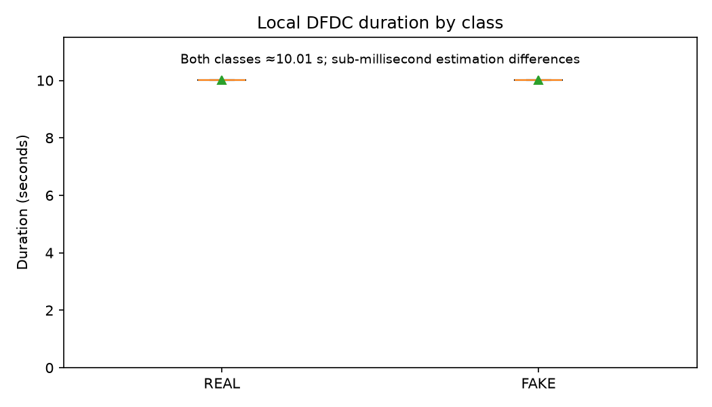
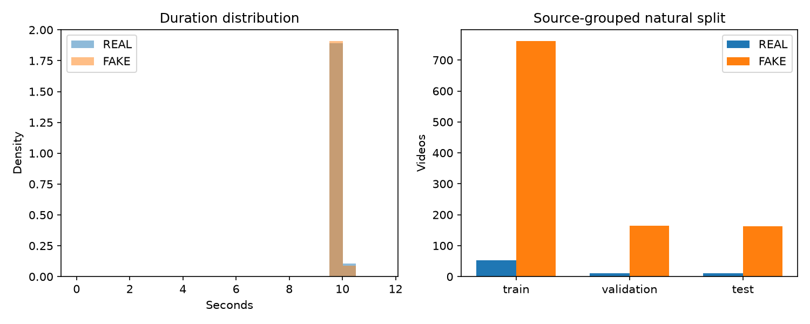
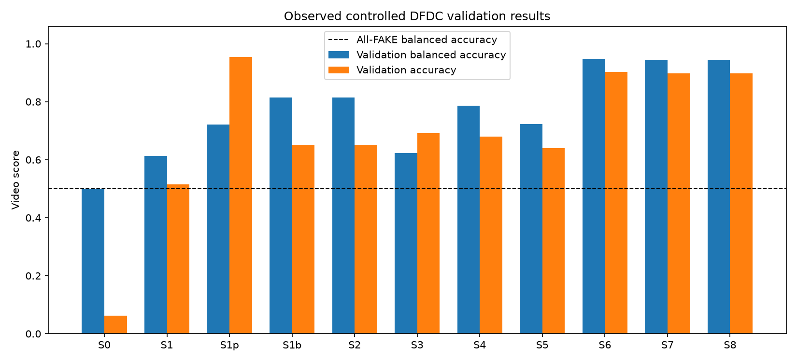
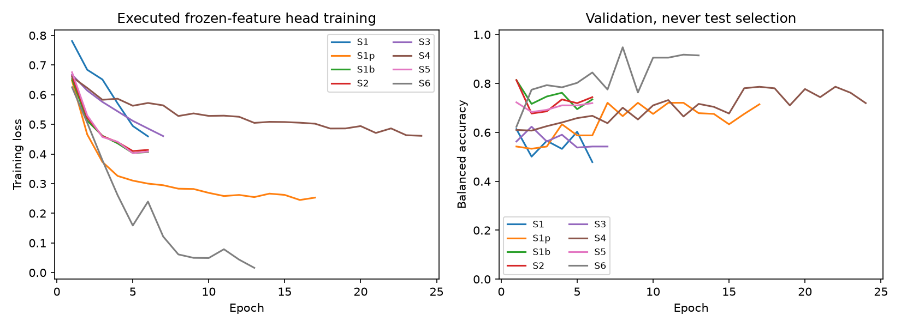
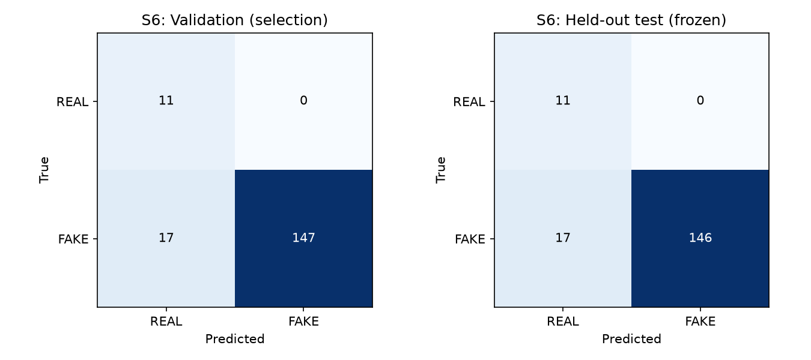
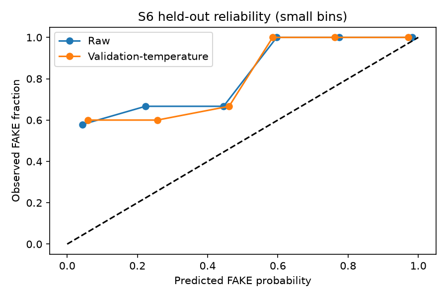

# Explainable Deepfake Classification: unified image/video experiments

Current debugging, XAI, latency and mixed-domain results are in [the executed refinement report](results/debug_refinement_20261019/REPORT.md). The original sealed video benchmark tables below remain historical results.

This repository preserves the image-trained ResNet-18 prototype and adds controlled transfer experiments on the **existing local DFDC subset**. The objective is to compare spatial CNN/ViT features, preprocessing, balancing, augmentation, a learned hybrid, and a lightweight temporal branch on one source-grouped video protocol. Results below are generated by `python -m tools.report_unified` from JSON/CSV logs, not manually supplied targets.

The validation-selected video champion is **S6 — EfficientNet-B0 + one-layer LSTM**, with validation balanced accuracy **94.82%** and one-time held-out test balanced accuracy **94.79%**. Test accuracy is **90.23%**; the all-FAKE test reference scores 93.68% accuracy with 0% REAL recall. These measurements apply to this local subset, not the complete DFDC benchmark or arbitrary images. Predicting FAKE for every local labeled video gives **93.63% accuracy and 50% balanced accuracy**.

## Data and reproducible split

No additional dataset was downloaded. Local media: **1163 MP4 files**, **1162 labeled** (74 REAL, 1088 FAKE). `elyvkuldpz.mp4` has no matching label and is logically quarantined in [quarantine.json](results/dfdc_unified_20261019/quarantine.json); it remains on disk but never enters training, calibration, validation, or test. The metadata contains 1334 entries, including files absent locally. Filename labels come from supplied local metadata of the Kaggle community mirror; this is not certified official distribution provenance. No label was inferred from a filename or prediction.

Original-to-derivative edges form connected components, including missing-original aliases. All videos in a component share a split; seed 42 searches deterministic group assignments near 70/15/15 without splitting a component. No frame-level split is used. Optional identity IDs are only grouped when supplied; this metadata does not establish actor-disjoint evaluation. Exact-file SHA-256 duplicates are checked across splits. Manifest SHA-256: `1b2bd9ec28c1b49f10b27201a484d825d6c8a4fa5e594447d81152c496d061c3`.

| Split | Videos | REAL | FAKE | Source groups |
|---|---:|---:|---:|---:|
| train | 813 | 52 | 761 | 54 |
| validation | 175 | 11 | 164 | 17 |
| test | 174 | 11 | 163 | 15 |

The common [manifest](results/dfdc_unified_20261019/manifest.csv) records every labeled file's hash, source, split, FPS, frame count, resolution, duration and decode status. [Audit JSON](results/dfdc_unified_20261019/audit.json), [media properties](results/dfdc_unified_20261019/media_properties.json). Decode failures: **0**. Probe scope: container properties and eight normalized sampled frames per labeled video, not exhaustive decoding of every frame. Failed clips, if any, are excluded uniformly before feature extraction.

| Class | Landscape 1920×1080 | Portrait 1080×1920 |
|---|---:|---:|
| REAL | 27 | 47 |
| FAKE | 238 | 850 |

Orientation proportions differ by class. Raw resizing can retain layout/background cues; cropping is a controlled comparison, not proof that a model learned manipulation traces. FPS and frame-count distributions, including per-class frame-count minimum/median/mean/maximum, are retained in the media-properties JSON. The cache-integrity report gives face fallback counts by split and class.

## Duration analysis and fixed video protocol

| Class | Videos | Total seconds | Min | P10 | P25 | Median | Mean | P75 | P90 | Max |
|---|---:|---:|---:|---:|---:|---:|---:|---:|---:|---:|
| REAL | 74 | 740.768 | 10.010 | 10.010 | 10.010 | 10.010 | 10.010 | 10.010 | 10.010 | 10.011 |
| FAKE | 1088 | 10891.305 | 10.010 | 10.010 | 10.010 | 10.010 | 10.010 | 10.010 | 10.010 | 10.011 |

Both class means are effectively 10.01 seconds; the microsecond-scale difference does not support a meaningful REAL-versus-FAKE duration shortcut in this cohort. Duration is reported as a potential shortcut and is never an input feature. This is descriptive analysis, not a significance claim. The classifier always receives exactly **eight distinct frames**, sampled at bin centers `(i+0.5)/8` of the frame-count timeline. Clips with fewer than eight frames or a failed sampled decode are rejected, never padded or replicated. All sequences have shape `8 × 3 × 224 × 224`, independent of class/duration.




Raw preprocessing decodes, converts BGR to RGB, resizes bilinearly to 224×224, then applies ImageNet normalization. Processed input applies the same YuNet largest-face detector and three-landmark affine alignment (margin 1.3) to both classes, then the same resizing/normalization. Detection failure explicitly falls back to the full frame; it is recorded per frame and is not a model input feature. Cache statuses: `{"yunet_landmark_aligned": 7845, "no_face_full_frame_fallback": 1451}`. No identity tracking or guaranteed face correspondence is claimed. Raw/aligned arrays are stored losslessly in a bounded shared uint8 cache; the same tensors are used by every compatible experiment. Val/test/inference never use stochastic augmentation.

| Split/class | Aligned frames | Full-frame fallbacks | Fallback rate |
|---|---:|---:|---:|
| test_FAKE | 1216 | 88 | 6.75% |
| test_REAL | 82 | 6 | 6.82% |
| train_FAKE | 4803 | 1285 | 21.11% |
| train_REAL | 360 | 56 | 13.46% |
| validation_FAKE | 1296 | 16 | 1.22% |
| validation_REAL | 88 | 0 | 0.00% |

Fallback rates differ across splits/classes, especially training FAKE versus validation FAKE. This is a preprocessing/distribution limitation: although detection status is not fed to the head, fallback pixels can retain different background/layout cues. [Cache integrity](results/dfdc_unified_20261019/cache_integrity.json) verifies original hashes, shape, sampled positions and the full metadata source graph. Decoder equivalence on two validation clips is recorded separately; all eight optimized samples were pixel-identical to repeated seeking.

## Transfer training and controlled progression

EfficientNet-B0 and DeiT-Tiny encoders use ImageNet-1K weights and remain frozen/eval, including normalization statistics. Each video is represented by eight 1280-D CNN or 192-D ViT embeddings; training-only feature mean/std standardize embeddings. A small linear head trains using the video mean of frame probabilities. This is feature-based transfer, **not full backbone fine-tuning**. DeiT-Tiny has native transformer self-attention; EfficientNet has native squeeze/excitation. No added ECA/CBAM improvement is claimed.

`S1 → S1p → S1b → S2` changes one factor at a time: raw → aligned face → video-balanced training → augmentation. Balanced training samples whole videos with inverse-class-frequency probabilities, replacement, one training-set length per epoch, and an unweighted loss. There is no simultaneous aggressive loss weighting. Natural validation/test distributions are retained. Augmentation chooses the original or one reproducible extra view per training video, with a shared horizontal flip/brightness/contrast/saturation transform across its eight frames. It does not duplicate a frame to make a sequence. A bounded extra-view feature cache limits augmentation diversity; it is not a permanent expanded labeled dataset.

New heads use seed 42, AdamW (LR .002, weight decay .01), 32-video batches, AMP, up to 24 epochs and patience 5. Checkpoint selection maximizes validation balanced accuracy, then macro-F1, then ROC-AUC. Unique `best.pt`, resumable `last.pt` (optimizer/scaler/epoch state), epoch history and config are retained. Shared frozen feature extraction is separately timed. Real CUDA forward/backward smoke checks precede each budget. No new image-dataset training was run.

The hybrid S5 concatenates frozen CNN and compact ViT embeddings and learns a small common classifier. S6 projects CNN embeddings to 64 dimensions and trains a one-layer 32-hidden LSTM with a video label. S7 is transparent late probability fusion of S2 spatial and S6 temporal scores; its spatial weight is 0.25, selected from .25/.5/.75 on validation. S8 combines the learned CNN–ViT S5 model with S6, using spatial weight 0.25; it represents the complete proposed spatial-hybrid/temporal system. S6 is temporal-head-only on spatial features; it still depends on a CNN encoder. Images bypass temporal computation and explicitly use S2 for S6/S7 and S5 for S8. These image fallbacks have no DFDC image-level accuracy claim.

## Validation comparisons (selection data)

Metrics use video labels REAL=0/FAKE=1 and decision threshold .5. The legacy checkpoint's FAKE=0 model output is explicitly remapped. Precision is FAKE precision; macro-F1 includes both classes. ROC-AUC and average-precision PR-AUC use FAKE as positive. Confusion matrices use rows/columns REAL, FAKE. Raw validation scores below precede temperature calibration.

| ID | Model/system | Preprocessing | Balance/augmentation | Attention | Temporal | VAL balanced acc | VAL accuracy | VAL macro-F1 | VAL ROC-AUC | Head training | Forward/video |
|---|---|---|---|---|---|---:|---:|---:|---:|---:|---:|
| S0 | Preserved image ResNet-18 | raw | natural | none | none | 50.00% | 6.29% | 0.0591 | 0.4972 | 0.0 s | 7.15 ms |
| S1 | EfficientNet-B0 | raw | natural | native SE | none | 61.36% | 51.43% | 0.4085 | 0.6946 | 1.1 s | 25.97 ms |
| S1p | EfficientNet-B0 | face | natural | native SE | none | 72.12% | 95.43% | 0.7657 | 0.8797 | 2.2 s | 27.77 ms |
| S1b | EfficientNet-B0 | face | video-balanced | native SE | none | 81.40% | 65.14% | 0.5183 | 0.8154 | 0.9 s | 23.72 ms |
| S2 | EfficientNet-B0 | face | video-balanced + augmentation | native SE | none | 81.40% | 65.14% | 0.5183 | 0.8110 | 0.8 s | 22.66 ms |
| S3 | DeiT-Tiny | raw | natural | native self-attention | none | 62.33% | 69.14% | 0.4958 | 0.6253 | 0.9 s | 18.51 ms |
| S4 | DeiT-Tiny | face | video-balanced + augmentation | native self-attention | none | 78.69% | 68.00% | 0.5294 | 0.8930 | 3.1 s | 19.20 ms |
| S5 | EfficientNet-B0 + DeiT-Tiny | face | video-balanced + augmentation | native self-attention | none | 72.31% | 64.00% | 0.4940 | 0.8054 | 0.8 s | 44.30 ms |
| S6 | EfficientNet-B0 + one-layer LSTM | face | video-balanced + augmentation | native SE | one-layer LSTM | 94.82% | 90.29% | 0.7547 | 0.9645 | 3.2 s | 24.82 ms |
| S7 | EfficientNet spatial + LSTM late fusion | face | video-balanced + augmentation | native SE | LSTM + late fusion | 94.51% | 89.71% | 0.7460 | 0.9562 | 0.0 s | 24.80 ms |
| S8 | CNN–ViT hybrid + LSTM combined system | face | video-balanced + augmentation | native self-attention | LSTM + late fusion | 94.51% | 89.71% | 0.7460 | 0.9579 | 0.0 s | 41.55 ms |
| Ref | All-FAKE constant rule | — | — | — | — | 50.00% | 93.71% | 0.4838 | 0.5000 | no training | not benchmarked |

Training times exclude the shared media audit/cache and encoder extraction. S0 has zero DFDC training cost; its historical image training is separate. S7/S8 reuse trained branches and have zero additional training. The forward column uses the [common runtime benchmark](results/dfdc_unified_20261019/runtime_benchmark.json): the same resident eight-frame validation input through each complete deployed encoder/head/fusion path, five warmups and 30 timed repeats. The legacy ResNet runs FP32; new frozen encoders use FP16 autocast and heads use FP32. Decode, face processing, CPU/GPU transfer, XAI and scalar calibration are excluded. Original summaries preserve earlier encoder-plus-head/branch estimates used before test release; retrospective timing does not change the frozen champion. Shared encoder forward time across all extracted views/splits: **146.6 s**, observed peak encoder VRAM **129.6 MiB**. Per-run head/inference VRAM, complete model artifact sizes, hashes and exact metrics are in [comparison.csv](results/dfdc_unified_20261019/comparison.csv) and [comparison.json](results/dfdc_unified_20261019/comparison.json). Shared encoder files are needed in addition to each small head checkpoint. Final resumed cache pass: 457.6 s (earlier partial passes excluded); audit: 1407.3 s. Cache preparation uses two bounded CPU workers; model experiments run sequentially.




## Frozen held-out test and calibration

[freeze.json](results/dfdc_unified_20261019/freeze.json) seals checkpoint hashes, calibration temperatures, fusion weight, manifest and champion **before** test feature extraction/prediction. Every completed frozen configuration is evaluated once on the same natural test split; `test.claim` prevents silent reruns. Test metrics did not select a model or change a configuration. The deployment champion is chosen on validation with both class recalls nonzero, then balanced accuracy, macro-F1, AUC and cost. A local champion is not an external benchmark result.

Temperature scaling fits one positive scalar to **validation video** log probabilities/logits by minimizing log loss; no test labels enter calibration. It leaves the .5 class decision unchanged. Below, log loss, Brier and ECE use calibrated video scores; ranking metrics and class decisions remain unchanged. ECE uses ten equal bins of predicted-class confidence on [.5,1]. Small REAL counts make all calibration and recall estimates uncertain. No inconclusive threshold is deployed because this validation cohort cannot establish a reliable selective-risk guarantee. REAL/FAKE probabilities remain visible. Images use uncalibrated spatial scores rather than transferring a video calibration claim.

| ID | TEST balanced acc | Accuracy | REAL recall | FAKE recall | FAKE precision | Macro-F1 | ROC-AUC | PR-AUC/AP | Log loss | Brier | ECE |
|---|---:|---:|---:|---:|---:|---:|---:|---:|---:|---:|---:|
| S0 | 50.00% | 6.32% | 100.00% | 0.00% | 0.0000 | 0.0595 | 0.4808 | 0.9397 | 1.0674 | 0.4281 | 0.6065 |
| S1 | 56.22% | 73.56% | 36.36% | 76.07% | 0.9466 | 0.4958 | 0.5756 | 0.9480 | 0.6608 | 0.2334 | 0.2722 |
| S1p | 70.58% | 92.53% | 45.45% | 95.71% | 0.9630 | 0.6974 | 0.8645 | 0.9883 | 0.2043 | 0.0578 | 0.0370 |
| S1b | 75.52% | 62.07% | 90.91% | 60.12% | 0.9899 | 0.4903 | 0.8383 | 0.9872 | 0.6913 | 0.2489 | 0.1432 |
| S2 | 71.28% | 62.07% | 81.82% | 60.74% | 0.9802 | 0.4821 | 0.8305 | 0.9866 | 0.6941 | 0.2501 | 0.1532 |
| S3 | 58.67% | 78.16% | 36.36% | 80.98% | 0.9496 | 0.5240 | 0.5979 | 0.9523 | 0.5501 | 0.1641 | 0.1798 |
| S4 | 82.88% | 75.86% | 90.91% | 74.85% | 0.9919 | 0.5879 | 0.8661 | 0.9903 | 0.6122 | 0.1804 | 0.1017 |
| S5 | 75.88% | 70.69% | 81.82% | 69.94% | 0.9828 | 0.5390 | 0.8349 | 0.9870 | 0.6631 | 0.2259 | 0.1547 |
| S6 | 94.79% | 90.23% | 100.00% | 89.57% | 1.0000 | 0.7545 | 0.9593 | 0.9973 | 0.2816 | 0.0842 | 0.0621 |
| S7 | 93.56% | 87.93% | 100.00% | 87.12% | 1.0000 | 0.7214 | 0.9487 | 0.9966 | 0.3685 | 0.1005 | 0.0541 |
| S8 | 93.56% | 87.93% | 100.00% | 87.12% | 1.0000 | 0.7214 | 0.9520 | 0.9968 | 0.3416 | 0.0952 | 0.0730 |
| Ref | 50.00% | 93.68% | 0.00% | 100.00% | 0.9368 | 0.4837 | 0.5000 | 0.9368 | 2.2786 | 0.0632 | 0.0632 |




Each run directory has `validation_predictions.csv`, `test_predictions.csv`, `summary.json`, `test.json`, full confusion matrices, calibration before/after values and checkpoint hashes. [All-FAKE reference](results/dfdc_unified_20261019/all_fake_reference.json) provides natural-distribution validation/test baselines; its clipped log loss for deterministic errors is not a calibrated model.

## Prior image-only results (kept separate)

The preserved original ResNet-18 reports 97.115% historically; its earlier independently rerun full 20,000-image test yielded **97.12%**, balanced accuracy 97.12%, ROC-AUC 0.9973239. The one-image difference from the historical result was not isolated. Those image labels/splits differ from the new video benchmark. The earlier 12,000-train/2,000-validation image runs measured validation accuracy: E01 ResNet-18 90.80%, E02 EfficientNet-B0 92.45%, E03 B0+ECA 92.00%, E04 B0+JPEG augmentation 92.30%. The original had 100,000 training images; those values are not a controlled equal-budget comparison with it. Existing source logs are retained under [execution_20261019](results/execution_20261019); no image test was repeated to choose a DFDC configuration. The original `models/best_resnet18.pth` and `results/champion.json` remain preserved. No new XLSX report was created.

## Debugging and demo refinement — 19 October 2026

Full evidence, all 38 supplied-image runs (19 configurations), saved crops/tensors, exact commands and remaining limitations: [executed debugging report](results/debug_refinement_20261019/REPORT.md).

Verified: S2 reproduces the synthetic-image failure (16.13% FAKE); its 81.40% video balanced accuracy and 0.518 macro-F1 are consistent with `[[11,0],[61,103]]` on the imbalanced validation set. Checkpoint/class mapping is correct. S5 reproduces the reported 66.15% REAL example. Domain transfer and native preprocessing matter: applying DFDC alignment to the image-trained ResNet reverses its synthetic sanity prediction. A new separate S2 image validation benchmark measures 51.10% balanced accuracy; its video score is not an image score.

Fixed: legacy CLI bicubic/bilinear mismatch, IG sign loss and insufficient integration diagnostics, blue tint on zero maps, Grad-CAM++ small-gradient cutoff, and repeated interaction work. Existing deployed image scores were preserved exactly in all before/after pairs. Threshold tuning was audited on validation only and was not stable enough to change deployment. Historical test outputs remain untouched.

### Image-family ranking (common 2,000-image validation cohort)

| Family | Best variant | Best validation BA | Mean validation BA | Comparable runs |
|---|---|---|---|---|
| ResNet / CNN | S0 | 96.90% | 93.85% | 2 |
| EfficientNet | E02_efficientnet_b0 | 92.45% | 81.96% | 4 |

### Video-family ranking (common grouped DFDC validation cohort)

| Family | Best variant | Best validation BA | Mean validation BA | Comparable runs |
|---|---|---|---|---|
| Spatial + Temporal Hybrid | S6 | 94.82% | 94.61% | 3 |
| EfficientNet | S1b | 81.40% | 74.07% | 4 |
| Vision Transformer | S4 | 78.69% | 70.51% | 2 |
| CNN + ViT Hybrid | S5 | 72.31% | 72.31% | 1 |
| ResNet / CNN | S0 | 50.00% | 50.00% | 1 |

Families rank by their best validated compatible variant. Means count only completed comparable runs. S0 trained on 100,000 images, E01–E04 on 12,000, and S2 on DFDC videos; training budgets/domains differ. S0 remains the image default and S6 the video default. Unbenchmarked image transfers are optional and unranked. Model details expose datasets, checkpoint hashes, accuracy, macro-F1 and limitations.

## Previous explanation interface — 19 October 2026

This subsection records the earlier interface and its checks. The automatic gallery below supersedes its manual explanation controls.

CNNs: Grad-CAM, Grad-CAM++ (first-gradient-power approximation), Layer-CAM, signed IG, Occlusion Sensitivity and on-demand LIME. ViTs: IG, Occlusion, LIME, native attention rollout and gradient-weighted attention. Hybrids offer their compatible methods. Every explanation has a one-line description, REAL/FAKE target, color legend and opacity control. Attention is not causal proof; hybrid CAM localizes the CNN branch. Video perturbation/gradient XAI differentiates the selected complete decision with its video temperature and other frame embeddings held fixed.

IG uses batched Gauss–Legendre integration and exposes mean-color or blurred-input reference, signed raw statistics and completeness/convergence. Across 368 actual image/method/target checks on 15 deployed checkpoints, all maps were finite and scores unchanged. At 128 steps, 18 IG cases were numerically inconclusive; 2 maps were constant and 18 LIME fits weak. The UI flags them. Negative deletion results remain in the logs; these checks do not establish universal faithfulness.

Predictions and completed explanations use bounded Streamlit caches keyed by input/checkpoint, modality, method, target and parameters. Uploading classifies without XAI; Generate explanation computes only the selected method. Opacity changes reuse the map. Typical resident S2 synthetic prediction with Grad-CAM improved from 146.95 to 126.79 ms; prediction alone is 87.02 ms, and a cached prediction lookup is 0.89 ms. Timings exclude browser paint; cold GPU startup remains slower. [Detailed profiling](results/debug_refinement_20261019/profile.json).

REAL/FAKE MP4 video QA covered every frozen system (22 runs), deterministic eight-frame sampling, complete-system XAI and calibration parity. Lossless MOV remux, playback/preview controls and corrupt/missing input handling were checked. S6 correctly labels both selected clips; S0 still misses the FAKE clip. Notes and warnings, including temporal image fallbacks, remain in a collapsed section at the bottom.

The registered mixed-domain pilot used 2,000 training images and existing DFDC training data with balanced, equal domain losses and a frozen encoder:

| Run | Image validation BA | Image macro-F1 | Video validation BA | Video macro-F1 |
|---|---|---|---|---|
| baseline_S2 | 51.10% | 0.511 | 81.40% | 0.518 |
| dfdc_only_control | 53.00% | 0.528 | 79.57% | 0.495 |
| mixed_domains | 73.35% | 0.733 | 82.32% | 0.530 |

It improves S2 transfer but fails the registered joint champion rule, so it remains a research artifact. No supplied sanity image or test data entered training/selection. [Pilot registration and results](results/debug_refinement_20261019/domain_pilot/comparison.json).

Regression: 56 tests passed. Actual UI/upload/cache checks: 19 passed. Preserved originals use SHA-256-addressed local upload paths; metadata establishes provenance, not manipulation. Small source cohorts, crop/domain shift, weak/inconclusive attributions, shared validation calibration and cold startup remain limitations.


## Automatic explanation gallery — 20 October 2026

The demo uses a single **Detection model** list named after the actual components: for example, **EfficientNet-B0 + LSTM [f, b, a]** and **EfficientNet-B0 + LSTM (score fusion) [f, b, a]**. Tags identify the implementation: `v` baseline pipeline, `f` face detection/alignment, `b` class-balanced sampling, `a` training augmentation, `j` JPEG augmentation, and `img12k`/`img100k` image training counts. A legend appears below the selector, and the caption explains the selected heads and fusion. Internal checkpoint IDs remain in Model and evaluation details. Image and video defaults and validation rankings are unchanged.

Uploading runs every compatible XAI method automatically, including LIME. Two workers use independent copies of the loaded model and separate CUDA streams. Results appear in a scrollable gallery as methods finish. Each view explains why it is included, what it depicts, its colors and the branch/decision it covers. Completed suites are cached; changing opacity only reblends the maps. The explanation target is always the predicted class, so the old method selector, Generate button and REAL/FAKE target control are removed.

Heatmaps indicate model influence, not verified edit locations. A highlighted eye or mouth is a region to inspect; it does not establish that the feature was manipulated. REAL predictions can have localized support and do not require whole-face highlighting. Weak LIME fits, inconclusive IG and constant maps are labeled, with warnings in the collapsed bottom section.

See [demonstration guide and model-name mapping](docs/automatic_gallery.md). Reproduce current UI and concurrency checks with `python -m tools.verify_automatic_gallery --output results/gallery_rerun/app_qa.json` and `python -m tools.verify_parallel_attribution --output results/gallery_rerun/parallel_parity.json`. Use a new output path to preserve saved evidence.

## Run locally and reproduce

Source code and compact benchmark evidence are versioned. Datasets, model weights, uploads, diagnostic face media, tensors and runtime output stay local under the documented [artifact policy](results/README.md); checkpoints must be provisioned separately on another machine.

Hardware used: NVIDIA RTX 4060 Laptop GPU (8 GB), Ryzen 7 7840HS, approximately 16 GB RAM, existing CUDA-enabled `dfenv`. Frozen extraction uses eight-frame AMP batches; training uses 32 cached video sequences and zero data-loader workers. CPU inference fallback is supported; real end-to-end CPU verification is recorded separately. No training on CPU was substituted for the reported CUDA runs. Additional phase storage including downloaded media, caches, model weights and reports is **13.63 GiB / 30 GiB** (environment baseline excluded; added dependency reserve included). A 5 GiB free-disk reserve is enforced.

Executed package versions: `{"torch": "2.11.0+cu128", "torchvision": "0.26.0+cu128", "numpy": "2.4.6", "Pillow": "12.3.0", "scikit-learn": "1.9.0", "streamlit": "1.66.0", "timm": "1.0.22"}`. [Software/Python provenance](results/dfdc_unified_20261019/software_versions.json), [pretraining weight hashes](results/dfdc_unified_20261019/pretrained_provenance.json), and the local detector's `data/dfdc/runtime/yunet.json` bind the runtime and source weights. Shared encoder snapshots and unique head checkpoints retain independent SHA-256 hashes.

From PowerShell:

```powershell
Set-Location D:\sundarCollege\Deepfake_Detect\Deepfakereserch
.\dfenv\Scripts\Activate.ps1
python -m streamlit run app.py --server.address 127.0.0.1 --server.port 8501 --server.headless true
# Or: .\tools\start_demo.ps1
python -m unittest discover -s tests -v
```

Research stages are idempotent for completed outputs and resume partial training without changing configs. Existing final results are preserved:

```powershell
python -m training.video_protocol audit
python -m training.video_protocol cache
python -m tools.run_unified
python -m tools.verify_unified
python -m tools.report_unified
```

`run_unified` executes train/validation frozen embeddings → sequential heads → fusion → freeze → test embeddings → one-time test metrics. It never launches a download script. Frozen test claims require explicit investigation after interruption. To run a genuinely new protocol, use a new run/cache namespace rather than editing these sealed results. Pretrained encoder weights and head checkpoints are local ignored artifacts, not committed data. Install requirements in `dfenv` only if recreating the environment; the verified local runtime includes `timm==1.0.22`.

## Limitations of the historical sealed experiments

This is a small, highly imbalanced convenience subset with relatively few independent source groups and REAL validation/test videos. Related derivatives are grouped, but unidentified actors may cross groups. Source-level bootstrap confidence intervals and an external distribution test were not run. There is no claim of complete DFDC, cross-dataset video generalization, 95–97% DFDC accuracy, semantic artifact diagnosis, or monotonic improvement from face processing, balance, augmentation, native attention, hybridization or temporal modeling. Eight samples omit most moments; largest-face fallback and frame-count-based seeking can fail on unusual containers or variable-frame-rate media. Decode probes are limited to the sampled positions.

The first temporal-XAI integration run failed because cuDNN evaluation-mode RNNs cannot backpropagate. The repaired explanation path evaluates the same LSTM weights with the native differentiable backend; normal prediction/training are unchanged. A CUDA regression compares native explanation scores with normal inference and checks input gradients. Initial failed logs remain preserved. UTF-8 model-name decoding on Windows was also corrected without altering numerical results. Constant maps are displayed with an explicit localization-unavailable notice.

Frozen features and a small fixed augmentation-view cache limit adaptation. No added ECA/CBAM, temporal transformer, full end-to-end fine-tuning or independent DFDC image benchmark was completed in this phase; these are explicitly deferred, not reported as successful experiments. S7 reuses branch checkpoints and its cost estimate is not an independent measurement. Temperature and head selection share the validation subset, so calibration estimates there are optimistic. The same held-out test is shared across frozen comparisons, and small counts limit conclusions. Runtime CUDA mixed precision versus FP32 explanation computation may introduce small numerical differences; validation checks compare deployed scores with cached protocol scores. Further work should preregister a new source/actor-aware cohort, increase REAL group coverage, use a separate calibration set, study attribution stability on more clips and benchmark end-to-end latency under representative loads.
